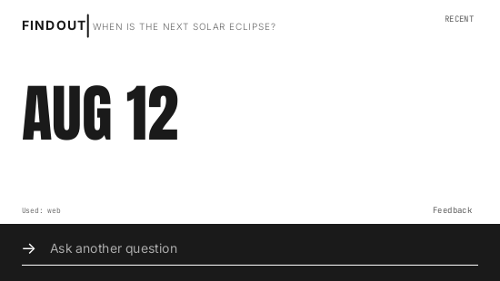

# FindOut

**Answers, without breaking your flow.**

Looking something up usually means opening a browser, searching, and digging
through pages. FindOut is a tiny popup instead: press a shortcut, ask, and get a
straight answer. It searches the web when needed, reads screenshots from your
clipboard, and knows enough about your system to answer "how do I…" questions.

**Alt+Space** on Windows · **Super+Space** on Linux · **Option+Space** on macOS

## Get it

[Download the latest release](https://github.com/MOEG-5/FindOut-client/releases/latest)
for Windows, Linux, or macOS, or use the [web app](https://findout-pwa.vercel.app)
in any browser. Enter `trial` when asked for a key to get free daily usage. No
accounts or API keys.

The web app can also sit on your home screen and open like a regular app, without
an app store:

- **iPhone:** in Safari, tap **Share** (on iOS 26 and later it is under **•••**
  next to the address bar), then **Add to Home Screen** → **Add**.
- **Android:** in Chrome, tap **⋮**, then **Install app** or **Add to home screen**.
- **Computer:** in Chrome or Edge, click the install icon at the right end of the
  address bar.

---

[Website](https://moeg-5.github.io/FindOut-client/) ·
[Privacy](PRIVACY.md) ·
[Development](docs/development.md) ·
[GPL-3.0](LICENSE)
